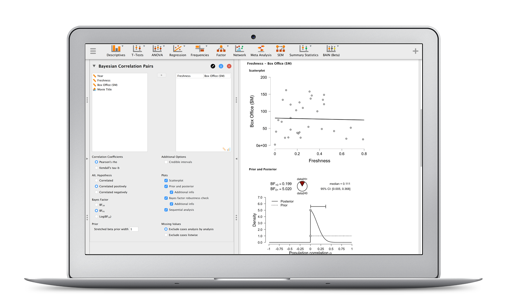
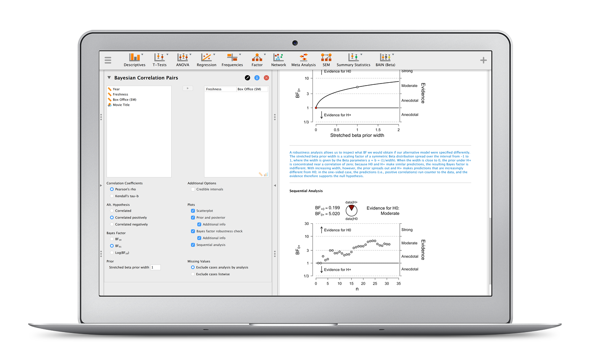
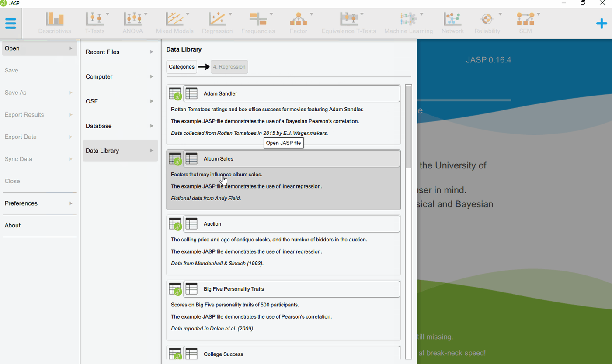

# JASP-Bridge

以 **WorkBuddy 为对话入口**、**JASP 为统计引擎**的 MCP 插件。用户在 WorkBuddy 里用自然语言提需求，插件把需求整理成可确认的分析计划，再调用本机 JASP/R 执行，最后把结果以 Markdown 表格 + APA 报告提示返回对话。

> 当前状态（0.3.1，2026-11-27）：**22 类**可运行分析，15 个 MCP 工具。可直接加载 Excel（`.xlsx` / `.xls`）和 SPSS（`.sav`）。已修复部分 MCP 宿主改写数组/布尔参数导致计划校验失败或 JASP 报错的问题。类型推断不再仅凭唯一值把均分判成有序变量；用户未指定题项或因子时，插件会给出可确认的建议方案，确认前不执行。统计数字、表、图和 `.jasp` 只由本机 JASP 引擎产生，宿主只负责转发和展示。其中 `RegressionLinear`、配对 t、ANCOVA、ANOVA 仍标 beta。本机没有 R/jaspTools 时会进入 **dry-run**，只生成可复现工件，不产生统计数字。
>
> 源码与 Release：https://github.com/nanple/jasp-bridge
> 随包实用指南见 [GUIDE.md](GUIDE.md)，图文版见 `docs/visual-guide.pdf`，示例数据在 `examples/demo.csv`、`examples/factor-demo.csv`、`examples/mixed-demo.csv`。
> WorkBuddy 实际加载的是 `~/.workbuddy/jasp-bridge`，不是桌面上的交付文件夹。
> 非 WorkBuddy 宿主（DeepSeek/豆包/千问）见 [SUPPORT-DEEPSEEK-DOUBAO.md](SUPPORT-DEEPSEEK-DOUBAO.md) 和 `configs/`。

---

## JASP 介绍

[JASP](https://jasp-stats.org/) 是由阿姆斯特丹大学支持的开源统计软件，面向科研与教学，界面友好，点选即可完成分析，结果会随选项即时更新。本插件是 WorkBuddy 与本机 JASP 之间的桥接器：在对话里用自然语言提出分析需求，由插件整理成可确认的计划，再调用 JASP 输出表格、图形和 `.jasp` 文件。统计数字始终来自 JASP，而不是宿主 AI 自行计算。

### 界面与结果

以下截图来自 [JASP 官网](https://jasp-stats.org/)。

**主界面。** 顶部是分析模块，左侧是选项，右侧会随勾选即时显示结果。



**分析结果。** 假设检验、效应量与图形可以一起给出，改选项后输出会马上更新。



**`.jasp` 示例文件。** 官方数据图书馆同时提供数据和已经做好的分析；打开 `.jasp` 即可看到数据、选项和结果。本插件也会写出可在 JASP 中打开的 `.jasp` 文件。



### 与 SPSS 的对比

JASP 免费开源，结果随选项即时更新，假设检验与效应量同时给出，通常不必写语法（点选即可），由社区持续迭代。SPSS 需要商业授权，分析流程相对固定，结果往往在独立输出窗口中一次性生成。本插件选择对接 JASP，是为了在本机得到可打开、可复核的分析，并保持免费开源。

---

## 1. 它解决什么

- **对话直接驱动 JASP**：不用记菜单路径，也不用学 R 语法。
- **先计划后执行**：变量映射、方法选择、前提检查先给用户确认，避免"AI 直接算错变量"。
- **数字只来自 JASP**：插件不生成统计量，只做计划、调用与格式化；WorkBuddy 负责解释与写作。
- **数据不出本机**：`.csv` 快照、分析请求、结果都落在本地会话目录。
- **可复现**：每次运行保存 `request.json` + `data.csv` + `run_analysis.R` + `result.json`。

---

## 2. 架构

```
用户 ⇄ WorkBuddy（对话 / MCP Host）
          │  stdio（command / args / env）
          ▼
   JASP-Bridge MCP Server（本仓库）
   ├─ server.js        15 个工具、会话编排
   ├─ plan/            自然语言 → 分析计划 → JASP 选项
   ├─ data/            CSV/TSV/JSON/Excel/SPSS → 数据字典 + 快照
   ├─ jasp/detect.js   JASP / Rscript / jaspTools 能力探测
   ├─ jasp/rRunner.js  后台调用 Rscript（无头）
   ├─ jasp/cliRunner.js 调用 JASP CLI 重放 .jasp 模板
   └─ jasp/parse.js    结果表 → Markdown
          │
          ▼
   JASP（自带 R 引擎）或 Rscript + jaspTools
```

### 通信与数据流

1. **WorkBuddy → 插件**：MCP stdio，工具参数走 JSON Schema 校验。
2. **插件 → JASP**：
   - **无头 R（默认）**：常驻 `scripts/worker.R` 只加载一次 `jaspTools`，之后通过 JSON 行协议连续执行分析；`scripts/run_analysis.R` 保留为一次性回退。
   - **JASP CLI 模板重放**：对已有 `.jasp` 模板，调用 `JASP <template.jasp> --inputDataDir ... --outputDir ...` 换数据重跑并导出 HTML/PDF。
   - **dry-run**：R 未就绪时只生成请求与脚本，不出数。
3. **插件 → WorkBuddy**：Markdown 结果 + 工件路径；数值全部来自 JASP/R 返回。

---

## 3. 安装

### 3.1 一键安装（推荐，方案 B）

从 GitHub Release 下载官方便携包 [jasp-bridge-0.3.1-portable.zip](https://github.com/nanple/jasp-bridge/releases/download/v0.3.1/jasp-bridge-0.3.1-portable.zip)，解压后在该目录运行：

```powershell
powershell -ExecutionPolicy Bypass -File .\install.ps1
```

脚本会依次完成：

1. 把插件复制到 `~/.workbuddy/jasp-bridge`；
2. 定位本机 JASP（Store 版或桌面版）；
3. 从本机 JASP 构建离线运行时（约 1.7 GB，首次较慢）；
4. 写入 `~/.workbuddy/mcp.json`；
5. 运行 `jasp_status` 自检。

常用参数：

```powershell
.\install.ps1 -SkipRuntime    # 已有运行时，跳过复制
.\install.ps1 -Force          # 重建扁平库与模块结构
.\install.ps1 -NoMcp          # 只安装，不写 mcp.json
.\install.ps1 -JaspPath "<你的JASP安装目录>\JASPDesktop.exe"   # 非标准安装位置
.\install.ps1 -NodePath "C:\Program Files\nodejs\node.exe"
```

### 3.2 无头执行（离线运行时）

推荐直接运行：

```powershell
powershell -ExecutionPolicy Bypass -File .\scripts\setup_runtime.ps1
```

它会从本机 JASP 复制 `R` 与 `Modules` 到 `~/.workbuddy/jasp-bridge/runtime`，建立去重扁平库，并补齐 `jaspTools` 与模块入口。**不需要 GitHub、不需要单独安装 R**。

如果你已经有 R + `jaspTools`，也可以手动准备：

```r
install.packages("remotes")
remotes::install_github("jasp-stats/jaspTools")
jaspTools::setupJaspTools()
```

然后设置 `RSCRIPT` 与 `JASP_RUNTIME`，或在 `mcp.json` 里显式指定。

> 常驻 worker 首次启动需要加载 `jaspTools`，通常 5–10 秒；后续分析约 0.1–6 秒。首次冷启动可能更慢。

### 3.3 JASP（CLI 报告模式）

插件会自动探测两种安装：

- **传统安装**：`C:\Program Files\JASP\JASP.exe`
- **Microsoft Store 安装**：通过 `Get-AppxPackage` 找到 `WindowsApps\...\JASPDesktop.exe`

也可以手动指定：

```bat
set JASP_PATH=C:\Program Files\JASP\JASP.exe
:: 或者 Store 版
set JASP_PATH=C:\Program Files\WindowsApps\45842JASP.JASP_0.99.10.0_x64__wz6q9dg667qsj\JASPDesktop.exe
```

`jasp_run_template` 使用 JASP 0.99.x 的 `--report` 模式：

```bat
JASPDesktop.exe <template.jasp> --report <输出目录> --logToFile --timeOut=5
```

会生成 `report.pdf`、`dashboard/index.html`、`dashboard/results.json`。注意：

- 0.99.10 的 `--help` **没有** `--inputDataDir` / `--outputPdf`，所以不能用 CLI 直接换数据；模板会使用自身内嵌数据。
- `--hide` 在该版本与 `--noSandbox` 组合时可能导致崩溃，默认不传。

### 3.4 接到 WorkBuddy

把 `mcp.json.example` 复制到：

- 用户级：`~/.workbuddy/mcp.json`
- 项目级：`<项目目录>/.workbuddy/mcp.json`

改成实际路径：

```json
{
  "mcpServers": {
    "jasp-bridge": {
      "command": "node",
      "args": ["C:/path/to/jasp-bridge/src/server.js"],
      "env": {
        "JASP_BRIDGE_HOME": "C:/Users/<you>/.workbuddy/jasp-bridge",
        "JASP_RUNTIME": "C:/Users/<you>/.workbuddy/jasp-bridge/runtime",
        "JASP_BRIDGE_TIMEOUT_MS": "300000"
      }
    }
  }
}
```

不填 `JASP_PATH` 时会自动探测传统安装与 Store 安装。保存后重启 WorkBuddy，在 MCP 服务器列表看到绿色状态即可。之后直接说"帮我看看这份数据的描述统计"就会触发。

---

## 4. 工具清单

| 工具 | 作用 |
| --- | --- |
| `jasp_status` | 环境自检，返回可用后端 |
| `jasp_load_data` | 加载 CSV/TSV/JSON/Excel（.xlsx/.xls）/SPSS（.sav），建立会话 |
| `jasp_ingest_data` | 从对话粘贴内容建数据集 |
| `jasp_describe_data` | 变量字典、缺失、水平、描述统计 |
| `jasp_list_methods` | 列出已封装方法与变量角色 |
| `jasp_plan_analysis` | 自然语言 → 可确认的分析计划（可含建议题项与因子结构，不执行） |
| `jasp_confirm_plan` | 确认计划 |
| `jasp_update_plan` | 增量修改变量/方法/选项 |
| `jasp_run` | 提交执行，返回 `run_id` |
| `jasp_run_status` | 轮询状态与日志尾部 |
| `jasp_get_results` | 取 Markdown/JSON 结果，并返回 JASP 生成的图片 |
| `jasp_export` | 导出 request / template / R 脚本 / Markdown / 结果 CSV / JASP 复现包 |
| `jasp_progress` | 读取当前项目进度快照（阶段、已完成、下一步、待办、分析清单） |
| `jasp_run_template` | 用 `.jasp` 模板调 JASP `--report` 生成 PDF/HTML |

### 当前支持的 22 类分析

| 方法 | JASP 分析 | 状态 |
| --- | --- | --- |
| `descriptives` | `Descriptives` | stable |
| `reliability` | `reliabilityUnidimensionalFrequentist` | stable |
| `correlation` | `Correlation` | stable |
| `ttest_independent` | `TTestIndependentSamples` | stable |
| `paired_ttest` | `TTestPairedSamples` | beta（新封装） |
| `ancova` | `Ancova` | beta（新封装） |
| `anova` | `Anova` | beta（含事后比较、简单效应、预设/自定义对比） |
| `rm_anova` | `AnovaRepeatedMeasures` | 实测通过（宽格式，单一被试内因子 + 可选组间因子） |
| `process` | `ClassicProcess` | 实测通过（Model 1 / 4 / 6 / 7 / 8 / 14 / 15；可 FIML） |
| `efa` | `exploratoryFactorAnalysis` | 实测通过（至少 3 个观测变量；KMO/Bartlett、载荷、碎石图） |
| `pca` | `principalComponentAnalysis` | 实测通过（至少 3 个变量；特征值、碎石图、成分载荷） |
| `cfa` | `confirmatoryFactorAnalysis` | 实测通过（未给因子结构时先给建议，确认后再跑） |
| `sem` | `SEM` | 实测通过（未给语法时可先给建议测量模型，确认后再跑） |
| `plssem` | `PLSSEM` | 实测通过（需 PLS 复合测量语法 + bootstrap CI） |
| `mimic` | `MIMIC` | 实测通过（指标 ≥ 3，预测变量须为连续或二分） |
| `latent_growth` | `LatentGrowthCurve` | 实测通过（至少 3 个连续重复测量变量） |
| `mixed_lmm` | `MixedModelsLMM` | 实测通过（随机截距，可选随机斜率） |
| `mixed_glmm` | `MixedModelsGLMM` | 实测通过（二项 / Poisson / 高斯族） |
| `mixed_blmm` | `MixedModelsBLMM` | 实测通过（rstanarm；说“贝叶斯线性混合模型”） |
| `mixed_bglmm` | `MixedModelsBGLMM` | 实测通过（Bernoulli / Poisson / 高斯等族） |
| `process_bayesian` | `BayesianProcess` | 实测通过（同一套 Hayes 模型；说“贝叶斯中介/调节”） |
| `regression` | `RegressionLinear` | beta（复杂模型项需在 GUI 固定） |

---

## 5. 典型对话流程

```text
用户：我有一份绩效数据，帮我看看满意度、年龄、工龄对绩效的影响，再比较性别差异。

WorkBuddy → jasp_load_data(path)
插件：已加载 8 行 × 7 列；session_id = s_xxx
          ↓
WorkBuddy → jasp_plan_analysis("描述统计 + 回归 + 性别差异")
插件：计划 p_xxx：描述统计 → 相关 → 回归 → 独立样本 t 检验
      变量映射：dependent=perf, covariates=[age,sat1], group=gender
      需要确认：满意度题项 sat1–sat3 是否先做信度？
          ↓
用户：先做信度，再继续。
          ↓
WorkBuddy → jasp_update_plan(patch) → jasp_confirm_plan
WorkBuddy → jasp_run → jasp_run_status → jasp_get_results
插件：Markdown 表格 + APA 提示 + 工件路径
          ↓
用户：共线性怎么写进讨论？
WorkBuddy：基于同一会话结果解释，不重算。
```

---

## 6. 进度接口（让另一个助手接手）

项目带一个只读 HTTP 端口，把当前进度直接暴露出来，别的机器人（grok bot / 另一个 IDE 会话）抓一次就能接手：

```powershell
npm run progress                      # 默认 127.0.0.1:8787
npm run progress -- --host 0.0.0.0    # 允许局域网访问
npm run progress -- --port 9000
```

| 端点 | 内容 |
| --- | --- |
| `GET /progress.json` | 机器可读快照：阶段、已完成、下一步、已知问题、待办、22 类分析清单、最近改动文件、会话记录、安装副本漂移 |
| `GET /progress.md` | 同一份内容的 Markdown 简报（含「在别的机器人里继续用的提示词」） |
| `GET /handoff.md` `/readme.md` `/guide.md` `/changelog.md` | 文档原文 |
| `GET /analyses.json` | 每个分析的关键字、JASP 分析名、变量角色 |
| `GET /files?days=7` | 最近改动的文件与时间 |
| `GET /tests?run=1` | 现场跑 `npm run smoke` 并返回通过/失败统计 |
| `GET /sessions` | 插件记录的会话与运行 |
| `POST /todos` | 写入待办清单（`{"content":"...","status":"pending"}`） |

MCP 侧也提供同名工具 `jasp_progress`（`format=markdown|json`），两种接入方式读到的是同一份 `PROGRESS.json` + 仓库现状。

---

## 7. 关于 `.jasp` 文件

`.jasp` **不是普通 JSON，而是 ZIP 归档**，内部包含：

- `internal.sqlite`：数据与列元数据
- `analyses.json`：分析注册表
- `resources/N/jaspResults.json`：各分析结果

`jasp_export(format=jasp)` 会生成真正的 `.jasp` 文件：写入分析选项，并在有对应成功运行时写入查看器结果（`status=complete`）和官方内部 `jaspResults`。可用 JASP 打开并 Refresh。无对应运行结果时，仍只写入数据与选项。

此外仍会生成可复现工件（`request.json`、`run_analysis.R`、结果 CSV）和 JASP 复现包（bundle zip）。对已有 `.jasp` 模板，`jasp_run_template` 使用 `--report` 导出 PDF/HTML。需要说明：0.99.x 的 `--report` 是**导出模板中已有的分析结果**，不是用新数据重算；按当前 CLI，`--inputDataDir` 不可用。若要用新数据重算，请走无头 R + `jaspTools`，或在 JASP 图形界面中换数据后另存。

---

## 8. 已知限制

- 数据文件支持 `.csv`、`.tsv`、`.json`、Excel（`.xlsx` / `.xls` / `.xlsm`）和 SPSS（`.sav`）。多工作表 Excel 默认读取第一张表，可用 `jasp_load_data` 的 `sheet` 参数指定表名或从 1 开始的序号。`.sav` 会保留变量标签、值标签和 measure 类型（`types` 仍可手动覆盖）。密码保护或加密的工作簿无法读取，需先取消密码；宏（`.xlsm`）只读数据、不会执行。旧版 `.xls` 对非常古老或带复杂对象的工作簿可能不兼容。内部仍会写成 CSV 快照再交给 JASP。
- 类型推断不再仅凭唯一值数量：带小数的均分/总分视为 `scale`，1–5 / 1–7 题项仍为 `ordinal`，年龄等范围明显不是量表题的整数列为 `scale`。若仍需纠正，用 `types` 参数覆盖。
- P0 只解析结果表，不解析图；图可通过 `jasp_run_template` 导出 HTML/PDF。
- 重复测量 ANOVA 目前只封装**单一被试内因子**（多个水平用多列表示），可叠加 1–2 个组间因子；多因素被试内设计（如 2×3）需导出请求后手工扩展因子定义。
- `rm_anova` 暂不支持自定义 contrast 与边际均值；需要时请在 JASP GUI 中补做。
- Process 支持 Model 1 / 4 / 6 / 7 / 8 / 14 / 15；双调节、并行多中介尚未封装。对话中提到缺失或 FIML 时可用 FIML，否则默认 listwise。中介默认 1000 次 bootstrap，单次约 30–90 秒。
- 简单效应支持一个调节因子，也可以加第二个调节因子（三因素）；数据需平衡，有空格子时 JASP 无法估计。对比支持预设类型（Helmert / 多项式 / 重复 / 差异 / 偏差 / 简单）与 `options.contrasts` + `options.customContrasts` 传入的任意系数矩阵。
- EFA/PCA 至少需要 3 个观测变量。只说“做 EFA / CFA / SEM”且未指定题项或因子时，插件会根据列名、前缀和类型给出建议方案（明确标为建议，须确认后才执行）；也可继续显式传入 `options.factors` / `options.models`。这不是自动定稿，也不会在确认前开跑。
- 混合模型支持 LMM、GLMM（二项 / Poisson / 高斯等）以及贝叶斯版本（MixedModelsBLMM / MixedModelsBGLMM）和贝叶斯 Process。分组因子必须是每组多观测的 ID 列。贝叶斯分析默认 MCMC 为 3 条链、500 次 burn-in、1000 次抽样，可能需要几分钟。
- `anova` / `rm_anova` / `regression` 的复杂选项（`modelTerms`、`postHoc`）在不同 JASP 版本间结构可能变化；运行时若报"选项不存在"，按提示在 JASP GUI 核对后固定模板。
- `jaspTools` 是开发/测试向工具链，内部函数（如 `resultsTables`）可能随版本变化；脚本已做 fallback walker。
- 一次 `jasp_run` 只执行一个分析；多分析请生成多个计划并依次运行（WorkBuddy 可自动编排）。
- **Store 版 JASP 的自带 R 位于 `WindowsApps`，受 ACL 限制，不能直接作为 `Rscript` 执行**；`setup_runtime.ps1` 会把它复制到 `~/.workbuddy/jasp-bridge/runtime` 后再使用。若复制失败，可改用独立 R。
- Store 版 0.99.10 的 `--report` 不支持替换数据目录；`jasp_run_template` 的 `data_dir` 参数目前仅作兼容保留。

---

## 9. 故障排查

| 现象 | 处理 |
| --- | --- |
| `JASP: 未找到` | 设置 `JASP_PATH`，或在 WorkBuddy 的 MCP 环境变量里写绝对路径 |
| Store 版已安装但未识别 | 运行 `npm run status`；插件会通过 `Get-AppxPackage` 探测 `JASPDesktop.exe`，也可手动指定 `JASP_PATH` |
| `jaspTools: 未安装` | 按 3.2 安装**独立 R**；Store 版自带 R 不能被外部调用 |
| `jasp_run` 返回 dry-run | 正常降级：R 未就绪。安装后重跑 |
| `选项不存在` | 用 `jasp_export(format=request)` 看实际请求，在 JASP GUI 核对键名；或用 `jaspTools::analysisOptions("分析名")` 列默认键 |
| 中文变量名异常 | 确保 CSV 为 UTF-8；JASP 侧列名大小写敏感 |
| 模板报告无输出 | 确认 `report.complete`/`report.pdf`；不要同时传 `--hide` 与 `--noSandbox`；也可先手动跑一次 `JASPDesktop.exe --help` |

---

## 10. 路线图

- **当前（0.3.1）**：在 0.3.0 的类型推断与可确认分析方案之上，可直接读取 Excel（`.xlsx` / `.xls`）和 SPSS（`.sav`）；并修复部分 MCP 宿主改写数组/布尔参数的问题。宿主应展示插件返回的表、图和 `.jasp`，不要自行计算。
- **下一步（3.0 仍未做部分）**：测量等值、元分析、功效分析、更接近 APA 的表格、图中使用可读变量名（而非 `jaspColumnN`）、更稳定地打开 `.jasp` 文件；以及更完整的缺失值策略（FIML）。

---

## 11. 开发

```bash
npm run status   # 环境探测
npm run smoke    # 单元 + MCP 协议 + 端到端（dry-run）
npm start        # 以 stdio 启动 MCP 服务（通常由 WorkBuddy 拉起）
```

---

## 12. 开源分发与国内网络

### 11.1 发布形态

**A. 便携 zip（推荐给普通用户，方案 B）**

```powershell
.\build-release.ps1 -Version 0.3.1 -IncludeNode
```

生成：

```text
dist/jasp-bridge-0.3.1-portable.zip
```

官方 0.3.1 便携包约 41 MB，内含 `node_modules`、`src`、`scripts`、文档、示例和 Windows `node.exe`，**不**包含约 1.7 GB 的 JASP 运行时。运行时在安装时从用户本机 JASP 复制。不加 `-IncludeNode` 时体积约 5.5 MB，安装后需使用系统或 WorkBuddy 已有的 Node。

**B. npm 包（给开发者，目前未发布）**

如果以后发布 npm 包，再使用类似 `npm install -g @yourscope/jasp-bridge` 的方式安装。当前请用便携 zip 或开发目录。

**C. 公开下载地址**

- 仓库：https://github.com/nanple/jasp-bridge
- 便携包：https://github.com/nanple/jasp-bridge/releases/download/v0.3.1/jasp-bridge-0.3.1-portable.zip
- 更新清单 `latest.json`：https://github.com/nanple/jasp-bridge/releases/latest/download/latest.json

### 11.2 国内网络方案

| 依赖 | 方案 |
| --- | --- |
| 源码 / Release | 官方仓库与 Release 在 GitHub：https://github.com/nanple/jasp-bridge ；如访问较慢，可自行使用镜像或对象存储 |
| npm 依赖 | `registry.npmmirror.com`；便携 zip 直接内置 `node_modules` |
| R 包 | 清华 CRAN：`https://mirrors.tuna.tsinghua.edu.cn/CRAN/` |
| `jaspTools` | 优先用 `setup_runtime.ps1` 从本机 JASP 构建，完全不需要 GitHub；备选是 Gitee 镜像 + `remotes::install_git()` |
| JASP 安装包 | Microsoft Store，或对象存储镜像 |
| 单文件加速 | jsDelivr、ghproxy 类代理仅作兜底，不写死单一地址 |

核心原则：**安装完成后日常分析不访问 GitHub**。`setup_runtime.ps1` 只做本地文件复制，`worker.R` 只读取本地运行时。

### 11.3 发布检查清单

- `npm run smoke` 全绿；
- `setup_runtime.ps1` 在干净用户目录可重复执行；
- `install.ps1` 能正确合并已有 `mcp.json`（会先备份）；
- `build-release.ps1` 生成 zip 与 SHA256；
- README / `latest.json` 填写真实 GitHub 下载地址与 SHA256；
- 不把 `runtime/`、`sessions/`、`.test-home/`、`tmp_*` 打进仓库或 zip。

---

## 13. 插件更新

当前支持 **检查 + 下载 + SHA256 校验 + 手动确认安装**，不会静默替换正在运行的代码。

### 12.1 配置更新源

在 `mcp.json` 的 `env` 里加更新清单地址。官方地址：

```json
{
  "JASP_BRIDGE_UPDATE_URL": "https://github.com/nanple/jasp-bridge/releases/latest/download/latest.json"
}
```

`latest.json` 格式见 `latest.json.example`：

```json
{
  "version": "0.3.1",
  "url": "https://.../jasp-bridge-0.3.1-portable.zip",
  "sha256": "<64 位十六进制>",
  "notes": "更新说明",
  "runtime_required": false,
  "min_plugin_version": "0.2.0"
}
```

### 12.2 在 WorkBuddy 中检查

```text
检查插件更新
```

对应工具 `jasp_check_update` 只读取清单并比较版本，不下载。

确认有新版本后：

```text
下载更新
```

对应工具 `jasp_download_update` 会：

1. 下载 zip 到 `updates/<version>/`；
2. 校验 SHA256；
3. 解压并确认 `src/server.js` 存在；
4. 返回一条 `update.ps1` 安装命令。

### 12.3 安装更新

先关闭 WorkBuddy，再运行返回的命令，例如：

```powershell
powershell -ExecutionPolicy Bypass -File "$HOME\.workbuddy\jasp-bridge\update.ps1" `
  -PackageDir "$HOME\.workbuddy\jasp-bridge\updates\0.3.1\package" `
  -InstallDir "$HOME\.workbuddy\jasp-bridge"
```

`update.ps1` 会：

- 备份当前 `src`、`scripts`、`package.json` 等；
- 替换插件代码；
- **保留** `runtime/`、`sessions/`、`updates/`、`mcp.json`；
- 失败时自动回滚；
- 成功后提示重启 WorkBuddy。

常用参数：

```powershell
-SkipNode     # node.exe 被占用时跳过替换
-SkipStatus   # 跳过完成后的自检（不建议）
-Force        # WorkBuddy 未关闭时强制执行（可能因文件锁失败）
```

如果 `latest.json` 里 `runtime_required: true`，安装后还要运行：

```powershell
.\scripts\setup_runtime.ps1 -Force
```

### 12.4 发布新版本

1. 修改 `package.json` 的 `version`（`PLUGIN_VERSION` 会自动跟随）；
2. 更新 `CHANGELOG.md`；
3. 运行 `build-release.ps1`；
4. 计算 zip 的 SHA256；
5. 上传 zip，并更新 `latest.json` 的 `version`、`url`、`sha256`；
6. 让用户调用 `jasp_check_update`。
